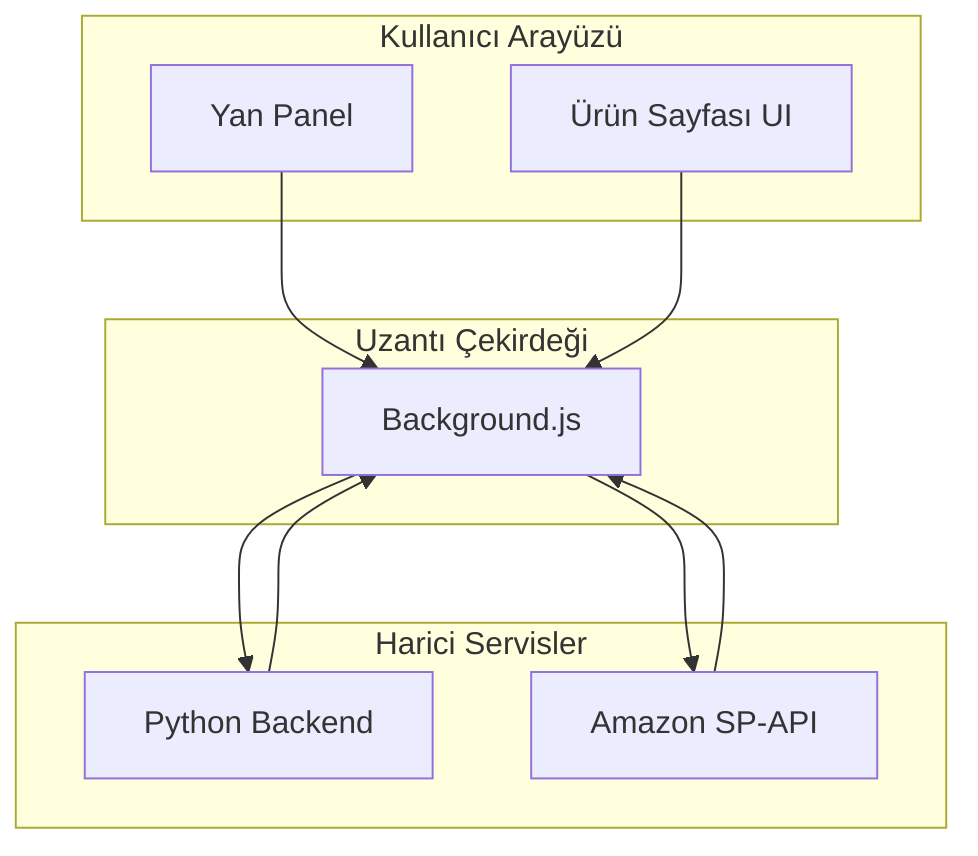

# FastChecker: Akıllı Amazon Satıcı Asistanı

 <!-- Varsayımsal banner linki -->

**FastChecker**, Amazon satıcıları için geliştirilmiş, veri odaklı kararlar almayı kolaylaştıran bir Chrome uzantısıdır. Ürün araştırma süreçlerinizi saniyeler içinde tamamlayarak, kârlılığınızı ve verimliliğinizi en üst düzeye çıkarın.

---

## ✨ Temel Özellikler

-   **🚀 Anında Ürün Analizi:** Bir Amazon ürün sayfasını ziyaret ettiğinizde, sayfanın içine entegre olan panelimiz sayesinde tüm kritik verilere anında ulaşın.
-   **📊 Kapsamlı Veri Paneli:**
    -   **Satılabilirlik Durumu:** Ürünün hesabınızda satılıp satılamayacağını anında öğrenin.
    -   **Akıllı Kâr Hesaplayıcı:** Maliyetinizi girin; potansiyel kâr, ROI ve başa baş satış fiyatını görün.
    -   **Zenginleştirilmiş BSR Analizi:** Satış sıralamasını (BSR) kategorisindeki yüzdelik dilimle ("Top 1%") birlikte analiz edin.
    -   **Rakip Analizi:** Üründeki diğer FBA ve FBM satıcılarını ve fiyatlarını listeleyin.
-   **🇪🇺 Avrupa Fiyat Karşılaştırması:** Arbitraj fırsatları için ürünün diğer Avrupa pazar yerlerindeki B2B fiyatlarını ve MOQ'larını tek bakışta görün.
-   **批量 ASIN Kontrolü:** Tarayıcının yan panelini kullanarak yüzlerce ASIN'in satılabilirlik durumunu aynı anda, hızla kontrol edin.
-   **📥 CSV Olarak Dışa Aktarma:** Toplu kontrol sonuçlarını tek tıkla CSV formatında bilgisayarınıza indirin.

## 🏗️ Teknik Mimari ve Felsefe

FastChecker, sorumlulukların net bir şekilde ayrıldığı modern bir istemci-sunucu mimarisi kullanır:

1.  **Chrome Uzantısı (Frontend):** Sadece kullanıcı arayüzünü sunar ve kullanıcı etkileşimlerini yakalar. Hızlı ve hafiftir.
    -   **`content.js`:** Amazon ürün sayfalarına analiz panelini enjekte eder.
    -   **`sidepanel.js`:** Toplu ASIN kontrolü için yan panel arayüzünü yönetir.
    -   **`background.js`:** Uzantının beyni. Tüm iletişimi yöneten bir API ağ geçidi (API Gateway) görevi görür.

2.  **Python Backend (Sunucu):** Tüm ağır işleri yapan motor.
    -   **Veri Toplama ve İşleme:** Amazon'dan ham veriyi toplar, temizler ve yapılandırır.
    -   **Veri Zenginleştirme:** BSR analizi, kur dönüşümleri gibi katma değerli bilgiler ekler.
    -   **SP-API Entegrasyonu:** Güvenli ve merkezi bir şekilde Amazon Selling Partner API ile iletişim kurar.

Bu mimari, sistemi **modüler, ölçeklenebilir ve bakımı kolay** hale getirir.

## 🚀 Kurulum

Detaylı kurulum talimatları için lütfen aşağıdaki kılavuzu inceleyin:

➡️ **[Kurulum ve Kullanım Kılavuzu](./proje_dokumantasyonu/01_Kurulum_ve_Yapilandirma.md)**

## 📚 Proje Dokümantasyonu

Projenin iş ve teknik detaylarını daha derinlemesine anlamak için aşağıdaki dokümanları inceleyebilirsiniz:

-   **[Ürün Gereksinimleri Dokümanı (PRD)](./proje_dokumantasyonu/Product_Requirements_Document.md):** Projenin hedeflerini, hedef kitlesini ve iş mantığını açıklar.
-   **[Teknik Tasarım Dokümanı (TDD)](./proje_dokumantasyonu/Technical_Design_Document.md):** Projenin mimarisini, bileşenlerini, veri akışını ve güvenlik önlemlerini detaylandırır.

## 🛠️ Geliştirme

Projeye katkıda bulunmak veya kendi yerel ortamınızda geliştirmek için lütfen **[Kurulum Kılavuzu'nun Geliştiriciler İçin Bölümünü](./proje_dokumantasyonu/01_Kurulum_ve_Yapilandirma.md#bölüm-2-geliştiriciler-için-kurulum)** takip edin.

## 🤝 Katkıda Bulunma

Katkılarınız bizim için değerlidir! Lütfen bir "issue" açarak veya bir "pull request" göndererek projeyi daha iyi hale getirmemize yardımcı olun.

---

*FastChecker ile Amazon'da bir adım önde olun.*