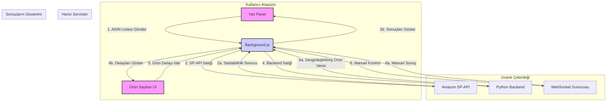

# FastChecker Projesi: Genel Bakış

## 1. Projenin Amacı

FastChecker, Amazon satıcıları için geliştirilmiş bir Chrome uzantısıdır. Temel amacı, satıcıların ürün araştırma ve analiz süreçlerini otomatize ederek verimliliklerini artırmaktır. Uzantı, iki ana işlevsellik üzerine kuruludur:

1.  **Toplu ASIN Kontrolü:** Satıcıların, bir ürün listesinin (ASINs) kendi hesaplarında satılıp satılamayacağını hızlıca kontrol etmelerini sağlar.
2.  **Detaylı Ürün Analizi:** Satıcılar bir Amazon ürün sayfasını ziyaret ettiğinde, sayfanın içine zengin ve eyleme geçirilebilir veriler enjekte ederek anında karar vermelerine yardımcı olur.

## 2. Ana Bileşenler

Proje, modern bir Chrome uzantısı mimarisi kullanır ve üç ana teknik bileşenden oluşur:

### a. Yan Panel Arayüzü (Side Panel UI)

-   **Konum:** Tarayıcının yan panelinde yaşar.
-   **Sorumluluk:** Kullanıcıların Amazon SP-API (Selling Partner API) kimlik bilgilerini güvenli bir şekilde girmelerini ve birden çok ASIN'i toplu olarak kontrol etmelerini sağlar.
-   **Teknoloji:** HTML, CSS, JavaScript. `sidepanel.js` bu arayüzün tüm mantığını yönetir.

### b. Ürün Sayfası Arayüzü (Browser UI / Content Script)

-   **Konum:** Amazon ürün detay sayfalarına (`/dp/...`) dinamik olarak eklenir.
-   **Sorumluluk:** Ziyaret edilen ürünle ilgili kritik verileri (kar hesaplayıcısı, BSR analizi, rakip satıcılar, diğer pazar yerlerindeki fiyatlar vb.) görsel olarak zengin bir arayüzde sunar.
-   **Teknoloji:** JavaScript (`content.js`), CSS (`product-ui.css`). Sayfanın DOM yapısına müdahale ederek çalışır.

### c. Arka Plan Hizmetleri (Background Service Worker & Backend)

-   **Konum:** Uzantının arka planında sürekli çalışır (`background.js`) ve harici bir Python sunucusu (`backend_new/app.py`) ile iletişim kurar.
-   **Sorumluluklar:**
    -   **`background.js`:** Yan panel ve ürün sayfası arayüzleri arasında bir köprü görevi görür. Tüm API isteklerini yönetir, WebSocket bağlantılarını idare eder ve farklı bileşenler arasında mesajlaşmayı sağlar.
    -   **Python Backend (`app.py`):** Amazon'dan ham verileri (web scraping veya API yoluyla) toplar, işler, zenginleştirir (örn. BSR analizi, kur dönüşümleri) ve `content.js`'in kullanabileceği temiz bir JSON formatında sunar.

## 3. Teknik Akış Şeması

## 4. Kod Yapısı ve Konvansiyonlar

-   **UI Ayrımı:** `GEMINI.md` dosyasında belirtildiği gibi, Yan Panel ve Ürün Sayfası UI'larının kod tabanları ve sorumlulukları kesin bir şekilde ayrılmıştır. `background.js` bu iki dünya arasında bir aracıdır.
-   **Asenkron İletişim:** Tüm bileşenler (`sidepanel`, `content`, `background`) `chrome.runtime.onMessage` ve `chrome.tabs.sendMessage` API'ları üzerinden asenkron olarak haberleşir. Bu, uzantının donmadan ve akıcı bir şekilde çalışmasını sağlar.
-   **Güvenlik:** Hassas SP-API anahtarları `chrome.storage.local` kullanılarak kullanıcının makinesinde saklanır ve sadece gerektiğinde `background.js` tarafından okunur.
-   **Harici Backend:** Ürün sayfalarındaki karmaşık veri toplama ve işleme mantığı, uzantının kendisinden ayrı bir Python backend'ine taşınmıştır. Bu, uzantıyı daha hafif tutar ve bakımını kolaylaştırır.
