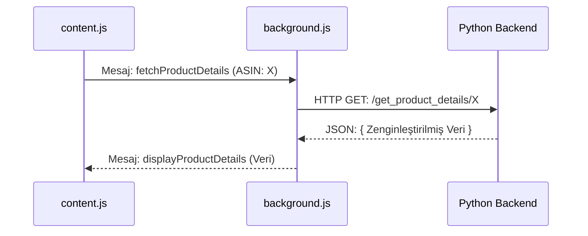

# FastChecker Projesi: Arka Plan İşlemleri

Bu doküman, uzantının beyni olarak görev yapan `background.js` betiğinin ve `backend_new/app.py` Python sunucusunun sorumluluklarını, aralarındaki ilişkiyi ve önemli mantıksal akışları açıklar.

## 1. `background.js`: Uzantının Hava Trafik Kontrolörü

`background.js`, bir Service Worker olarak çalışır ve uzantının farklı parçaları arasında merkezi bir koordinatör (hub) görevi görür. Doğrudan bir kullanıcı arayüzü olmamasına rağmen, uzantının çalışması için en kritik bileşendir.

### Ana Sorumlulukları:

-   **Mesaj Yönlendirme:** Yan Panel (`sidepanel.js`) ve Ürün Sayfası Arayüzü (`content.js`) gibi farklı bileşenlerden gelen mesajları dinler (`chrome.runtime.onMessage`) ve bu mesajları uygun işlevlere veya hedeflere yönlendirir.
-   **API Çağrılarını Yönetme:** Güvenlik ve merkezileştirme amacıyla, tüm harici API çağrıları (Amazon SP-API, Python Backend) `background.js` üzerinden yapılır.
-   **Durum Yönetimi:** Toplu ASIN kontrolünün (`isCheckStopped`) veya WebSocket bağlantısının (`ws`) durumunu yönetir.
-   **WebSocket İletişimi:** Manuel ASIN kontrolü için WebSocket sunucusuyla bağlantı kurar, sunucudan gelen sonuçları dinler ve ilgili bileşenlere (Yan Panel) iletir.

### Önemli `if` Koşulları ve Mantıklar (`background.js`)

`chrome.runtime.onMessage` dinleyicisi, gelen tüm mesajları `request.action` değerine göre ayıran büyük bir `if/else if` bloğudur:

-   **`if (request.action === 'checkAsin')`:**
    -   **Tetikleyen:** Yan Panel'deki "Kontrol Et" butonu.
    -   **İşlev:** Yan Panel'den gelen ASIN listesini ve kimlik bilgilerini alır. `handleAsinCheck` fonksiyonunu çağırarak SP-API üzerinden toplu kontrol sürecini başlatır.

-   **`if (request.action === 'stopCheck')`:**
    -   **Tetikleyen:** Yan Panel'deki "Durdur" butonu.
    -   **İşlev:** `isCheckStopped` bayrağını `true` olarak ayarlar. `handleAsinCheck` fonksiyonundaki döngü bu bayrağı kontrol ederek bir sonraki ASIN'e geçmeden önce durur.

-   **`if (request.action === 'fetchProductDetails')`:**
    -   **Tetikleyen:** Bir ürün sayfası yüklendiğinde `content.js`.
    -   **İşlev:** `content.js`'den gelen ASIN ve pazar yeri bilgisiyle Python backend'indeki `/get_product_details/...` endpoint'ine bir `fetch` isteği yapar. Gelen sonucu, isteği yapan sekmeye (`tabId`) geri gönderir.

-   **`if (request.action === 'fetchEuMarketPrices')`:**
    -   **Tetikleyen:** Bir ürün sayfası yüklendiğinde `content.js`.
    -   **İşlev:** `content.js`'den gelen ASIN ile Python backend'indeki `/get_eu_business_prices/...` endpoint'ine bir `fetch` isteği yapar ve sonucu yine ilgili sekmeye geri gönderir.

-   **`handleAsinCheck()` içindeki `if (isApprovalRequired)`:**
    -   SP-API'den gelen yanıtta bir ürünün `APPROVAL_REQUIRED` (Onay Gerekli) olarak işaretlenip işaretlenmediğini kontrol eder. Eğer öyleyse, bu ASIN'i manuel kontrol için WebSocket sunucusuna gönderir.

## 2. `backend_new/app.py`: Veri İşleme ve Zenginleştirme Merkezi

Bu Python sunucusu, Flask veya FastAPI gibi bir web framework'ü kullanarak `background.js`'den gelen HTTP isteklerini karşılar. Uzantının kendisini hafif tutmak ve karmaşık veri işleme mantığını ayırmak için kullanılır.

### Ana Sorumlulukları:

-   **Veri Toplama (Scraping/API):** `background.js`'den bir istek aldığında, ilgili Amazon ürün sayfasından veya belki de başka Amazon API'lerinden gerekli ham verileri (fiyat, BSR, boyutlar, satıcılar vb.) toplar.
-   **Veri İşleme:** Topladığı ham veriyi temizler ve yapılandırır. Örneğin, "1.2 pounds" gibi bir metni `{ value: 1.2, unit: 'pounds' }` gibi yapısal bir veriye dönüştürür.
-   **Veri Zenginleştirme:** Ham veriye ek değer katar. Örneğin:
    -   **BSR Analizi:** Sadece BSR numarasını değil, aynı zamanda bu BSR'nin kendi kategorisindeki anlamını (örn: "Top 1%") hesaplar.
    -   **Kur Dönüşümü:** Farklı para birimleri arasında dönüşüm yapabilmek için güncel döviz kurlarını ekler.
-   **JSON Yanıtı Oluşturma:** Tüm bu işlenmiş ve zenginleştirilmiş veriyi, `content.js`'in kolayca kullanabileceği tek bir tutarlı JSON nesnesi olarak paketler ve HTTP yanıtı olarak döndürür.

### `app.py` içindeki Endpoint'ler:

-   **`/get_product_details/<asin>`:**
    -   Belirtilen ASIN için tüm ana ürün verilerini döndüren ana endpoint.
-   **`/get_eu_business_prices/<asin>`:**
    -   Belirtilen ASIN'in Avrupa pazar yerlerindeki (özellikle Business fiyatları) fiyatlarını ve Minimum Sipariş Miktarlarını (MOQ) döndüren özel endpoint.

## 3. Arka Plan Mimarisi Akış Şeması

